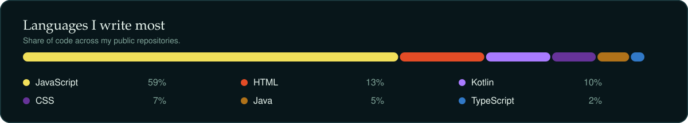

  

## About

I am a frontend and full-stack engineer who enjoys building and exploring software that makes everyday life simpler and more useful. My work centers on clean, maintainable code and thoughtful, user-focused design, and I value sharing what I build openly. I am always glad to collaborate on projects that create practical, meaningful impact.

## My Year in Contributions

  

## Stats

  

## Featured Projects

<!--PROJECTS:START-->

  
  
  
  

<!--PROJECTS:END-->

## Languages

  

## Connect

