  <picture>
    <source media="(prefers-color-scheme: dark)" srcset="assets/hero-dark.svg">
    <source media="(prefers-color-scheme: light)" srcset="assets/hero-light.svg">
    
  </picture>

## About

I am a frontend and full-stack engineer who enjoys building and exploring software that makes everyday life simpler and more useful. My work centers on clean, maintainable code and thoughtful, user-focused design, and I value sharing what I build openly. I am always glad to collaborate on projects that create practical, meaningful impact.

## My Year in Contributions

  <picture>
    <source media="(prefers-color-scheme: dark)" srcset="assets/contributions-dark.svg">
    <source media="(prefers-color-scheme: light)" srcset="assets/contributions-light.svg">
    
  </picture>

## Stats

  <picture>
    <source media="(prefers-color-scheme: dark)" srcset="assets/stats-dark.svg">
    <source media="(prefers-color-scheme: light)" srcset="assets/stats-light.svg">
    
  </picture>

## Featured Projects

<!--PROJECTS:START-->
<!--PROJECTS:END-->

## Languages

  <picture>
    <source media="(prefers-color-scheme: dark)" srcset="assets/stack-dark.svg">
    <source media="(prefers-color-scheme: light)" srcset="assets/stack-light.svg">
    
  </picture>

## Connect

